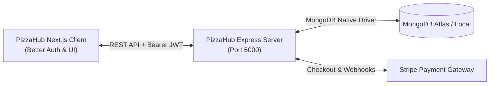

# PizzaHub — Backend API Server

[](https://nodejs.org/)
[](https://expressjs.com/)
[](https://www.mongodb.com/)
[](https://jwt.io/)
[](https://stripe.com/)

The **PizzaHub Backend API Server** is a robust, production-ready RESTful service built with Express 5, native MongoDB driver, and JSON Web Tokens. It powers the business logic, database persistence, role-based authorization, payment processing, and menu lifecycle workflows for the PizzaHub marketplace.

---

## Project Links

- **Live Website:** [PizzaHub](https://pizzahub-by-asif.vercel.app)
- **Client Repository:** [PizzaHub Client](https://github.com/asif213067/PizzaHub-Client)
- **Server Repository:** [PizzaHub Server](https://github.com/asif213067/PizzaHub-Server)

---

## Table of Contents

- [Architecture & Design Overview](#architecture--design-overview)
- [Key Features](#key-features)
- [Technology Stack](#technology-stack)
- [Project Directory Structure](#project-directory-structure)
- [Installation & Setup](#installation--setup)
- [Environment Variables](#environment-variables)
- [Available Scripts](#available-scripts)
- [API Reference](#api-reference)
  - [Authentication Routes (`/api/auth`)](#authentication-routes-apiauth)
  - [Menu Items (`/api/menu`)](#menu-items-apimenu)
  - [Order Management (`/api/orders`)](#order-management-apiorders)
  - [Customer Reviews (`/api/reviews`)](#customer-reviews-apireviews)
  - [Payments & Subscriptions (`/api/payments`)](#payments--subscriptions-apipayments)
  - [User Profiles (`/api/users`)](#user-profiles-apiusers)
  - [Admin Governance (`/api/admin`)](#admin-governance-apiadmin)
  - [Favorites (`/api/favorites`)](#favorites-apifavorites)
- [Database Schema & Collections](#database-schema--collections)
- [Security & Access Control (RBAC)](#security--access-control-rbac)
- [Deployment](#deployment)
- [Troubleshooting](#troubleshooting)
- [License & Repository](#license--repository)

---

## Architecture & Design Overview

PizzaHub uses a decoupled client-server architecture:



- **Next.js Client (`http://localhost:3000`)** handles UI rendering and initial authentication via Better Auth.
- **Express Server (`http://localhost:5000`)** verifies authenticated sessions, issues backend JWTs, executes database operations, and enforces business rules (such as menu moderation, vendor tier limits, order lifecycle states, and verified-purchase reviews).
- **Shared MongoDB Database** allows the Express server to look up Better Auth user records seamlessly while maintaining business collections (`menuItems`, `orders`, `reviews`, `transactions`).

---

## Key Features

1. **JWT Issuance & Better Auth Sync:** Exposes `/api/auth/jwt` to issue authoritative signed tokens for users registered through Better Auth, looking across both `users` and `user` collections.
2. **Authoritative RBAC (Role-Based Access Control):** Every request is verified against the database to guarantee that blocked users or role changes take effect immediately, independent of client state.
3. **Menu Item Moderation Pipeline & Multi-Image Support:**
   - Vendor creates or updates an item with up to 4 images (`images: string[]`) $\rightarrow$ Status is set to `pending`.
   - Admin approves or rejects $\rightarrow$ Status changes to `approved` or `rejected`.
   - Only `approved` items can be toggled `isActive: true` and displayed on the public menu.
4. **Tier-Based Vendor Limits:**
   - **Free Tier:** Strictly limited to 3 active menu items. Attempts to create additional items return a `400/403` limit error.
   - **Premium Tier:** Unlimited menu items with premium vendor attribution.
5. **Full Order Lifecycle:**
   - Customer places order with delivery date and address $\rightarrow$ `pending`.
   - Vendors receive orders for their products $\rightarrow$ `accepted` or `rejected`.
   - Customer can cancel their order while it is `pending`.
   - Vendors are strictly prevented from ordering their own items.
6. **Verified-Purchase Reviews & Admin Moderation:**
   - Reviews are allowed **only** for orders with an `accepted` status.
   - Pending, rejected, or cancelled orders cannot be reviewed.
   - Duplicate reviews on the same order are blocked at the database level (`409 Conflict`).
   - Automatically re-aggregates `rating` and `numReviews` across the menu item on creation and deletion.
   - Platform administrators have complete review moderation authority (`GET /api/admin/reviews` and `DELETE /api/reviews/:reviewId`).
7. **Stripe Subscription Billing:**
   - Creates Stripe Checkout sessions for Monthly ($29.99) and Yearly ($287.90) Premium plans.
   - Handles raw Stripe webhook payloads to fulfill subscriptions upon payment.
   - Prevents duplicate active subscriptions.
8. **Admin Governance & User Moderation:**
   - Provides `/api/admin/overview` statistics on users, orders, revenue, items, and reviews.
   - Instant user blocking (`PATCH /api/admin/users/:id/block`) that prevents subsequent JWT issuance.
9. **Automated Database Index Initialization:**
   - Server automatically initializes and ensures single and compound indexes across `menuItems`, `orders`, `reviews`, `transactions`, and `users` on startup via `initIndexes()`, eliminating full collection scans and optimizing continuous vendor order polling.

---

## Technology Stack

| Dependency | Version | Purpose |
| :--- | :--- | :--- |
| **Node.js** | `>= 18.0.0` | Server JavaScript runtime environment |
| **Express** | `^5.3.0` | Web framework for routing, middleware, and request handling |
| **MongoDB** | `^7.9.0` | Official native MongoDB driver for database persistence |
| **jsonwebtoken** | `^9.0.3` | Cryptographic JWT signing and verification |
| **Stripe** | `^23.2.0` | Payment processing SDK for Checkout Sessions & Webhooks |
| **cors** | `^2.8.6` | Cross-Origin Resource Sharing middleware |
| **dotenv** | `^18.0.10` | Environment configuration loading |

---

## Project Directory Structure

```text
pizzahub-server/
├── index.js                      # Application entry point, CORS, route mounting, & server listener
├── package.json                  # Server dependencies, scripts, and type configuration
├── src/
│   ├── config/
│   │   └── db.js                 # MongoDB client singleton, connection pooling, and getCollection helper
│   ├── controllers/
│   │   ├── adminController.js    # Overview stats, user list, user blocking, transactions table
│   │   ├── authController.js     # JWT creation (/api/auth/jwt) & user session retrieval (/api/auth/me)
│   │   ├── favoriteController.js# User favorites list, add favorite, remove favorite
│   │   ├── menuController.js     # Public menu, vendor item CRUD, admin approval, availability toggle
│   │   ├── orderController.js    # Order placement, vendor feed, customer feed, status update, cancel
│   │   ├── paymentController.js  # Stripe checkout session, webhook handler, subscription status & cancel
│   │   ├── reviewController.js   # Order review submission, item reviews query, rating re-calculation
│   │   └── userController.js     # User & vendor profile retrieval and update
│   ├── middleware/
│   │   ├── auth.js               # verifyToken, requireRole (requireAdmin, requireVendor, requireCustomer)
│   │   ├── errorHandler.js       # Centralized error handler with formatted JSON error responses
│   │   └── notFound.js           # 404 handler for undefined API routes
│   ├── routes/
│   │   ├── adminRoutes.js        # Mounted at /api/admin
│   │   ├── authRoutes.js         # Mounted at /api/auth & /api/v1/auth
│   │   ├── favoriteRoutes.js     # Mounted at /api/favorites
│   │   ├── menuRoutes.js         # Mounted at /api/menu & /api/v1/menu
│   │   ├── orderRoutes.js        # Mounted at /api/orders & /api/v1/orders
│   │   ├── paymentRoutes.js      # Mounted at /api/payments
│   │   ├── reviewRoutes.js       # Mounted at /api/reviews
│   │   └── userRoutes.js         # Mounted at /api/users
│   ├── scripts/
│   │   ├── seedAdmin.js          # CLI script to initialize/update the master admin account
│   │   ├── seedMenuItems.js      # Optional seed script for initial dummy pizzas
│   │   └── verifyMenu.js         # Verification utility for menu collections
│   └── utils/
│       └── token.js              # signToken helper with configurable expiration
```

---

## Installation & Setup

### Prerequisites
- **Node.js:** v18.0.0 or higher
- **MongoDB:** MongoDB Atlas connection string or local MongoDB instance (`mongodb://localhost:27017`)
- **Stripe Account (Optional for live billing):** Stripe secret key & webhook secret

### 1. Clone & Navigate
```bash
git clone https://github.com/your-username/PizzaHub.git
cd PizzaHub/pizzahub-server
```

### 2. Install Dependencies
```bash
npm install
```

### 3. Configure Environment Variables
Create a `.env` file in the root of `pizzahub-server`:
```ini
PORT=5000
CLIENT_URL=http://localhost:3000

# MongoDB Connection
MONGODB_URI=mongodb+srv://<username>:<password>@cluster0.mongodb.net/?retryWrites=true&w=majority
DB_NAME=pizzahub

# JWT Signing Secret (Generate a strong 64-character random string)
JWT_SECRET=your_jwt_secret_key_minimum_32_characters_long

# Stripe Credentials (Optional for local testing without card payments)
STRIPE_SECRET_KEY=sk_test_your_stripe_secret_key
STRIPE_WEBHOOK_SECRET=whsec_your_webhook_signing_secret

# Administrator Account Seeding
ADMIN_EMAIL=admin@pizzahub.com
ADMIN_NAME=PizzaHub Master Admin
```

### 4. Seed the Master Admin Account
Run the database seeder to ensure the administrator account exists with `admin` privileges:
```bash
npm run seed:admin
```

### 5. Start the Server
```bash
npm start
```
The server will start listening at:
👉 **`http://localhost:5000`**

---

## Environment Variables

| Variable | Required | Default | Description |
| :--- | :---: | :--- | :--- |
| `PORT` | No | `5000` | Port on which the Express server listens. |
| `CLIENT_URL` | No | `http://localhost:3000`| Allowed frontend origin for CORS requests. |
| `MONGODB_URI` | **Yes** | — | MongoDB connection string (Atlas URI or local host). |
| `DB_NAME` | No | `pizzahub` | Name of the database to connect to. |
| `JWT_SECRET` | **Yes** | — | Secret key used to sign and verify JSON Web Tokens. |
| `STRIPE_SECRET_KEY` | Optional | `""` | Stripe API Secret Key for Checkout Sessions. |
| `STRIPE_WEBHOOK_SECRET` | Optional | `""` | Signing secret used to verify incoming Stripe webhook signatures. |
| `ADMIN_EMAIL` | No | `admin@pizzahub.com` | Email address designated for the administrative seed account. |
| `ADMIN_NAME` | No | `PizzaHub Master Admin` | Display name for the administrative seed account. |

---

## Available Scripts

Defined in `package.json`:

```bash
# Starts the server in production/normal mode using Node.js
npm start

# Runs the admin database seed script to create or promote the admin account
npm run seed:admin
```

---

## API Reference

### Authentication Routes (`/api/auth`)
| Method | Endpoint | Access | Description |
| :--- | :--- | :---: | :--- |
| `POST` | `/api/auth/jwt` | Public | Exchanges a verified email for a signed backend JWT token. |
| `GET` | `/api/auth/me` | Authenticated | Returns current authenticated user record from the database. |

### Menu Items (`/api/menu`)
| Method | Endpoint | Access | Description |
| :--- | :--- | :---: | :--- |
| `GET` | `/api/menu` | Public | Search and paginate approved, active pizzas with category and location filters. |
| `GET` | `/api/menu/:id` | Public | Retrieve a specific menu item by its MongoDB `_id` with vendor information. |
| `GET` | `/api/menu/:id/related` | Public | Retrieve other menu items published by the same vendor. |
| `GET` | `/api/menu/vendor/my-items`| Vendor | Returns all menu items owned by the authenticated vendor. |
| `POST` | `/api/menu` | Vendor | Create a new menu item (sets status to `pending`; enforces Free tier 3-item limit). |
| `PUT` | `/api/menu/:id` | Vendor | Update an existing menu item (price, description, images, availability). |
| `DELETE`| `/api/menu/:id` | Vendor | Delete a menu item owned by the vendor. |
| `GET` | `/api/menu/admin/all` | Admin | Query all platform menu items across `pending`, `approved`, and `rejected` statuses. |
| `PATCH`| `/api/menu/:id/status` | Admin | Moderation action: update item status to `approved` or `rejected`. |

### Order Management (`/api/orders`)
| Method | Endpoint | Access | Description |
| :--- | :--- | :---: | :--- |
| `POST` | `/api/orders` | Customer | Place an order for an approved menu item with delivery details. |
| `GET` | `/api/orders/my-orders` | Customer | Retrieve all orders placed by the authenticated customer. |
| `GET` | `/api/orders/:id` | Authenticated | Get full details of a specific order. |
| `PATCH`| `/api/orders/:id/cancel` | Customer | Cancel a customer order (only allowed if status is `pending`). |
| `GET` | `/api/orders/vendor-orders`| Vendor | Retrieve all orders received for the vendor's menu items. |
| `PATCH`| `/api/orders/:id/status` | Vendor | Accept or reject an incoming order (`status: "accepted" \| "rejected"`). |

### Customer Reviews (`/api/reviews`)
| Method | Endpoint | Access | Description |
| :--- | :--- | :---: | :--- |
| `GET` | `/api/reviews/item/:itemId` | Public | Get verified reviews, average rating, and review count for a menu item. |
| `GET` | `/api/reviews/order/:orderId` | Customer | Get the review submitted for a specific order. |
| `GET` | `/api/reviews/my-reviews` | Customer | Get all reviews authored by the authenticated customer. |
| `GET` | `/api/reviews/vendor` | Vendor | Get all reviews submitted for any of the vendor's products. |
| `GET` | `/api/reviews/admin/all` | Admin | Retrieve all customer reviews across all vendor products with pagination and filters. |
| `POST` | `/api/reviews` | Customer | Post a review (1–5 rating + comment) on an `accepted` order. |
| `PATCH`| `/api/reviews/:reviewId` | Customer | Edit customer's own review. |
| `DELETE`| `/api/reviews/:reviewId` | Customer / Admin | Delete a review (customers can delete own; admins can delete any with auto rating recalculation). |

### Payments & Subscriptions (`/api/payments`)
| Method | Endpoint | Access | Description |
| :--- | :--- | :---: | :--- |
| `POST` | `/api/payments/create-checkout-session`| Vendor | Initiates Stripe Checkout for Monthly or Yearly Premium subscription. |
| `GET` | `/api/payments/subscription-status` | Vendor | Returns current vendor tier (`free` \| `premium`), billing cycle, and expiration. |
| `POST` | `/api/payments/cancel-subscription` | Vendor | Cancels active premium plan; retains access until cycle expiration. |
| `GET` | `/api/payments/transactions` | Vendor | Returns transaction history and Stripe invoice receipts for the vendor. |
| `POST` | `/api/webhooks/stripe` | Stripe | Webhook endpoint receiving Stripe charge and checkout completion events. |

### User Profiles (`/api/users`)
| Method | Endpoint | Access | Description |
| :--- | :--- | :---: | :--- |
| `GET` | `/api/users/profile` | Authenticated | Retrieve authenticated user profile information. |
| `PATCH`| `/api/users/profile` | Authenticated | Update profile attributes (name, phone, address, businessName, image). |

### Admin Governance (`/api/admin`)
| Method | Endpoint | Access | Description |
| :--- | :--- | :---: | :--- |
| `GET` | `/api/admin/overview` | Admin | Comprehensive platform metrics (users, vendors, items, orders, revenue). |
| `GET` | `/api/admin/users` | Admin | Paginated list of registered customers and vendors with role filter. |
| `PATCH`| `/api/admin/users/:id/block` | Admin | Block or unblock an account (`{ isBlocked: boolean }`). |
| `GET` | `/api/admin/transactions` | Admin | Platform-wide payment transaction log. |
| `GET` | `/api/admin/reviews` | Admin | List all platform customer reviews with pagination, rating filters, and search query. |
| `DELETE`| `/api/admin/reviews/:reviewId` | Admin | Permanently delete any review with automatic menu item rating recalculation. |

### Favorites (`/api/favorites`)
| Method | Endpoint | Access | Description |
| :--- | :--- | :---: | :--- |
| `GET` | `/api/favorites` | Customer | Get saved/favorite menu items for the customer. |
| `POST` | `/api/favorites/:itemId` | Customer | Add a pizza to customer favorites. |
| `DELETE`| `/api/favorites/:itemId` | Customer | Remove a pizza from customer favorites. |

---

## Database Schema & Collections

| Collection | Purpose | Key Fields |
| :--- | :--- | :--- |
| `users` / `user` | Account credentials & metadata | `email`, `name`, `role`, `isBlocked`, `businessName`, `subscriptionPlan`, `createdAt` |
| `menuItems` | Pizza menu items | `itemName`, `vendorId`, `category`, `price`, `images`, `status`, `isActive`, `rating`, `numReviews` |
| `orders` | Customer delivery orders | `customerId`, `vendorId`, `itemId`, `deliveryDate`, `deliveryAddress`, `message`, `status` |
| `reviews` | Verified purchase ratings | `orderId`, `itemId`, `vendorId`, `customerId`, `customerName`, `rating`, `comment`, `createdAt` |
| `transactions` | Stripe payment logs | `vendorId`, `plan`, `amount`, `status`, `stripeSessionId`, `createdAt` |
| `favorites` | Customer bookmarks | `userId`, `itemId`, `createdAt` |

### Database Performance & Indexes (`initIndexes`)

To ensure high-throughput query performance, sub-millisecond lookups, and to prevent full-collection scans across high-frequency endpoints (e.g. continuous 60-second vendor order polling), the server automatically initializes the following indexes on startup via `initIndexes()` in `src/config/db.js`:

| Collection | Indexed Field(s) | Type / Direction | Optimization Target |
| :--- | :--- | :---: | :--- |
| `menuItems` | `{ status: 1, category: 1 }` | Compound | Fast public menu filtering and category searches |
| `menuItems` | `{ vendorId: 1, status: 1 }` | Compound | Vendor dashboard items query and status checks |
| `menuItems` | `{ createdAt: -1 }` | Single Descending | Sorting featured items and recent additions |
| `orders` | `{ customerId: 1, createdAt: -1 }` | Compound | Customer `/api/orders/my-orders` history stream |
| `orders` | `{ vendorId: 1, status: 1, createdAt: -1 }` | Compound | High-frequency 60s vendor polling `/api/orders/vendor-orders` |
| `reviews` | `{ itemId: 1 }` | Single | Public menu item reviews and rating calculations |
| `reviews` | `{ vendorId: 1 }` | Single | Vendor reviews overview and aggregate rating lookup |
| `reviews` | `{ orderId: 1 }` | Single (Unique) | Prevents duplicate reviews per order at the database layer |
| `reviews` | `{ customerId: 1 }` | Single | Customer review history |
| `transactions` | `{ vendorId: 1, createdAt: -1 }` | Compound | Vendor billing history and subscription transaction log |
| `users` | `{ email: 1 }` | Single (Unique) | Fast user credential lookup and JWT issuance |
| `users` | `{ role: 1 }` | Single | Admin user management and role-based filtering |

---

## Security & Access Control (RBAC)

1. **Role Enforcement Against Live Database:**  
   Roles asserted in JWT payloads are re-verified against the database in `verifyToken` (`src/middleware/auth.js`). If an administrator blocks an account or changes a role, all subsequent requests are blocked immediately with `403 Forbidden`.
2. **CORS Whitelist:**  
   The CORS middleware in `index.js` checks `CLIENT_URL` to restrict browser origin access.
3. **Cryptographic Webhook Signatures:**  
   The Stripe webhook route uses `express.raw({ type: '*/*' })` to preserve the unparsed body, allowing Stripe's cryptographic signature verification (`stripe.webhooks.constructEvent`).

---

## Deployment

The server can be deployed on any Node.js hosting platform (such as **Render**, **Railway**, **AWS Elastic Beanstalk**, or a **VPS**):

### 1. Production Build & Start
Ensure the start command in your deployment settings is set to:
```bash
npm start
```

### 2. Production Environment Checklist
- Set `NODE_ENV=production`.
- Provide a secure, high-entropy `JWT_SECRET`.
- Configure `CLIENT_URL` to the exact production domain of the Next.js frontend (e.g., `https://pizzahub.yourdomain.com`).
- Add the production server's outbound IP to the MongoDB Atlas Network Access IP Whitelist.
- Configure `STRIPE_WEBHOOK_SECRET` from the Stripe Dashboard Webhooks section pointing to `https://api.pizzahub.yourdomain.com/api/webhooks/stripe`.

---

## Troubleshooting

### 1. `MONGODB_URI is not defined in environment variables`
- **Cause:** Missing `.env` file or undefined `MONGODB_URI` variable.
- **Solution:** Verify that `.env` exists in the `pizzahub-server` directory and contains a valid MongoDB Atlas connection string.

### 2. `Unauthorized: Invalid or expired token`
- **Cause:** JWT token expired or signed with a different `JWT_SECRET`.
- **Solution:** Ensure `JWT_SECRET` in `pizzahub-server/.env` is consistent and has not been rotated while client tokens were active.

### 3. Stripe Webhook Verification Fails (`Webhook signature verification failed`)
- **Cause:** Raw request body parsed as JSON prior to signature checking.
- **Solution:** The server handles this automatically by registering `express.raw()` specifically on webhook endpoints. Ensure reverse proxies or middleware do not pre-parse the payload.

---

## License & Repository

This project was developed for educational and portfolio demonstration purposes.

- **Repository:** https://github.com/asif213067/PizzaHub-Client
- **Backend Service:** https://github.com/asif213067/PizzaHub-Server

---

## Author

**Asif Hosen**\
Full-Stack Developer

-   Website: https://togetherwe-client-by-asif.vercel.app
-   GitHub: https://github.com/asif213067
-   Linkedin: https://www.linkedin.com/in/asif-hosen

------------------------------------------------------------------------

Built with the goal of making local community service easier to
discover, organize, and join.
